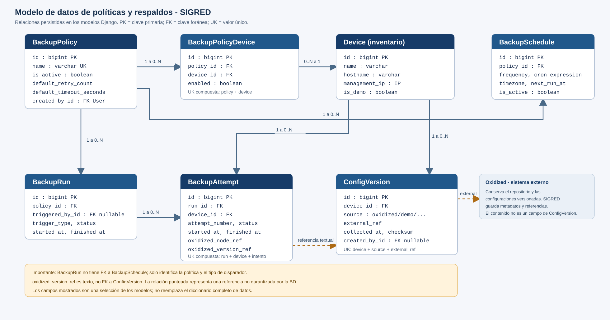
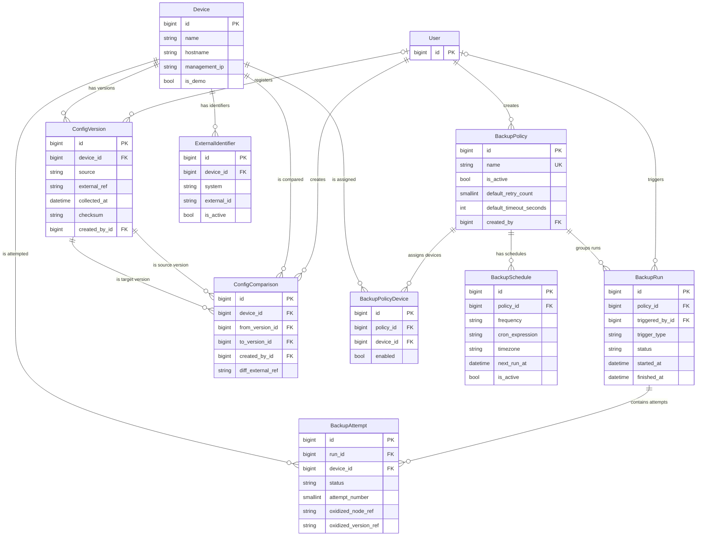
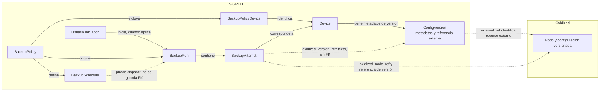
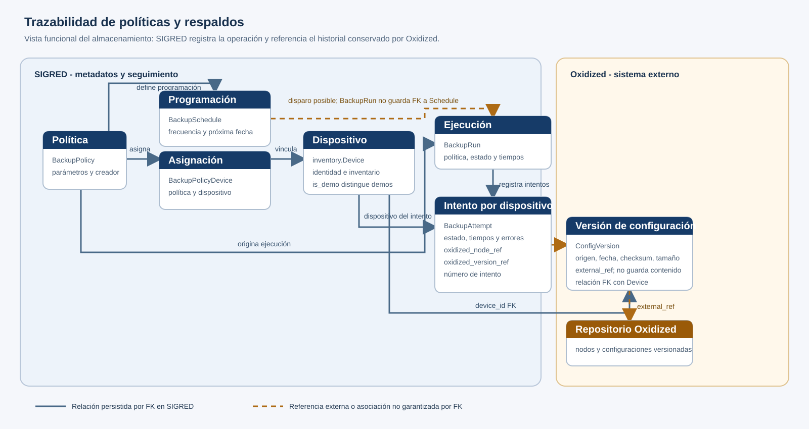

# Diagramas del modelo de políticas y respaldos

Estos diagramas describen las relaciones observadas en los modelos Django actuales. No representan una propuesta de migración.

## Diagrama entidad-relación

El SVG muestra las entidades centrales y una selección de campos para que sea legible. Las entidades `User`, `ExternalIdentifier` y `ConfigComparison` también tienen relaciones con estos modelos y se detallan en el diagrama Mermaid siguiente.

La relación entre `BackupAttempt.oxidized_version_ref` y `ConfigVersion.external_ref` es una referencia textual, no una clave foránea. `BackupSchedule` tampoco tiene una relación directa con `BackupRun`; una ejecución registra la política y el tipo de disparador, pero no cuál programación la originó.

<!-- mermaid-checked: every attribute is `<type> <name> [<key>] ["<description>"]` with at most one of PK/FK/UK, no \n in descriptions, no {} in descriptions, every relationship label is double-quoted -->

### Restricciones representadas o relevantes

- `BackupPolicy.name` es único.
- `BackupPolicyDevice` tiene una restricción única por pareja `policy_id` y `device_id`.
- `BackupAttempt` tiene una restricción única por `run_id`, `device_id` y `attempt_number`.
- `ConfigVersion` tiene una restricción única por `device_id`, `source` y `external_ref`.
- `BackupRun.triggered_by` y `ConfigVersion.created_by` son relaciones opcionales; el creador de una política y de una comparación es obligatorio.
- `BackupPolicyDevice.policy` y `BackupSchedule.policy` se eliminan en cascada con la política. La ejecución protege la política contra eliminación; los dispositivos asociados a intentos, asignaciones y versiones también usan protección contra eliminación.
- Algunas reglas temporales y de consistencia se validan en `clean()` de los modelos Django. El diagrama no implica que todas estén implementadas como restricciones SQL.

## Diagrama de trazabilidad y límites de responsabilidad

Las flechas continuas describen relaciones o datos que SIGRED persiste. Las flechas discontinuas indican asociaciones conceptuales por referencia textual o un disparo que no se registra mediante una FK.

La asociación entre `BackupAttempt.oxidized_version_ref` y `ConfigVersion.external_ref` debe entenderse como intención de vinculación mediante identificadores, no como integridad referencial garantizada por la base de datos. El contenido completo de configuración no aparece como campo de `ConfigVersion`; SIGRED conserva metadatos como origen, referencia externa, fecha de recolección y, opcionalmente, checksum y tamaño.

## Fuentes del modelo

- `backend/backups/models.py`: políticas, asignaciones, programaciones, ejecuciones, intentos, versiones y comparaciones.
- `backend/inventory/models.py`: dispositivos e identificadores externos.
- `backend/backups/migrations/0001_initial.py`: esquema inicial de respaldos y sus restricciones.
- `backend/inventory/migrations/0001_initial.py`: esquema inicial del inventario.
