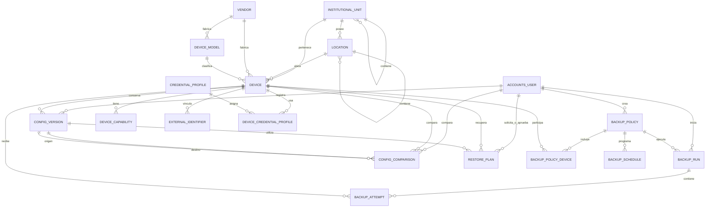

# Diccionario de base de datos de SIGRED

## 1. Propósito

Este documento describe las tablas actuales de SIGRED, sus campos principales y sus relaciones. Los nombres físicos están en inglés porque Django los genera a partir del nombre de la aplicación y del modelo:

```text
<aplicación>_<modelo>
```

Por ejemplo:

```text
inventory_device       → dispositivo del inventario
backups_backuprun      → ejecución de respaldo
accounts_user          → usuario de SIGRED
```

Esto no obliga a que la interfaz esté en inglés. Django utiliza `verbose_name` y `verbose_name_plural` para mostrar nombres en español en el panel administrativo.

## 2. Convenciones

- `PK`: clave primaria.
- `FK`: clave foránea.
- `NULL`: el valor puede quedar vacío en la base de datos.
- Las claves primarias `id` son enteros grandes autoincrementales (`BigAutoField`).
- Las fechas se almacenan con zona horaria y SIGRED trabaja con `America/Lima`.
- `PROTECT` impide borrar un registro que todavía está siendo utilizado.
- `CASCADE` elimina registros dependientes cuando se elimina su registro principal.
- Las contraseñas de dispositivos no se guardan directamente en estas tablas.

## 3. Vista general de relaciones



## 4. Módulo de usuarios

### `accounts_user`

Modelo: `accounts.User`.

Representa a las personas que ingresan a SIGRED. Extiende el usuario estándar de Django.

Campos principales:

| Campo | Tipo lógico | Descripción |
|---|---|---|
| `id` | PK | Identificador del usuario. |
| `username` | texto único | Nombre utilizado para iniciar sesión. |
| `password` | hash | Contraseña cifrada por Django; no se guarda en texto plano. |
| `first_name` | texto | Nombres. |
| `last_name` | texto | Apellidos. |
| `email` | texto | Correo electrónico. |
| `is_active` | booleano | Permite o bloquea el acceso. |
| `is_staff` | booleano | Permite ingresar al panel administrativo. |
| `is_superuser` | booleano | Otorga todos los permisos administrativos. |
| `last_login` | fecha y hora, NULL | Último inicio de sesión. |
| `date_joined` | fecha y hora | Fecha de creación. |

Relaciones auxiliares de Django:

- `accounts_user_groups`: usuarios asignados a grupos.
- `accounts_user_user_permissions`: permisos individuales por usuario.

## 5. Módulo de inventario

### `inventory_institutionalunit`

Modelo: `InstitutionalUnit`.

Representa la OTI, facultades, oficinas, laboratorios u otras unidades.

| Campo | Tipo lógico | Descripción |
|---|---|---|
| `id` | PK | Identificador. |
| `name` | texto | Nombre de la unidad. |
| `code` | texto, NULL | Código institucional opcional y único cuando existe. |
| `unit_type` | opción | `oti`, `faculty`, `office`, `laboratory` u `other`. |
| `parent_id` | FK, NULL | Unidad superior. Relación consigo misma. |
| `is_active` | booleano | Indica si continúa vigente. |
| `created_at` | fecha y hora | Creación. |
| `updated_at` | fecha y hora | Última modificación. |

Relación: una unidad puede contener muchas unidades hijas.

### `inventory_location`

Modelo: `Location`.

Representa sedes, edificios, pisos, ambientes y racks.

| Campo | Tipo lógico | Descripción |
|---|---|---|
| `id` | PK | Identificador. |
| `unit_id` | FK | Unidad institucional propietaria. |
| `name` | texto | Nombre de la ubicación. |
| `location_type` | opción | `campus`, `building`, `floor`, `room`, `rack` u `other`. |
| `parent_id` | FK, NULL | Ubicación superior. |
| `description` | texto | Información complementaria. |
| `is_active` | booleano | Vigencia. |
| `created_at` | fecha y hora | Creación. |
| `updated_at` | fecha y hora | Última modificación. |

Regla: una ubicación hija debe pertenecer a la misma unidad institucional que su ubicación superior.

### `inventory_vendor`

Modelo: `Vendor`.

Representa fabricantes como Cisco o Check Point.

| Campo | Tipo lógico | Descripción |
|---|---|---|
| `id` | PK | Identificador. |
| `name` | texto único | Nombre del fabricante. |
| `website` | URL | Sitio web opcional. |
| `is_active` | booleano | Vigencia. |

### `inventory_devicemodel`

Modelo: `DeviceModel`.

Representa un modelo técnico o comercial de dispositivo.

| Campo | Tipo lógico | Descripción |
|---|---|---|
| `id` | PK | Identificador. |
| `vendor_id` | FK | Fabricante del modelo. |
| `name` | texto | Nombre del modelo. |
| `device_family` | texto | Familia del producto. |
| `device_type` | opción | Switch, router, firewall, access point, servidor de red u otro. |
| `notes` | texto | Observaciones. |
| `is_active` | booleano | Vigencia. |

Restricción: la combinación `vendor_id + name` es única.

### `inventory_device`

Modelo: `Device`.

Es la tabla central del inventario. Representa un dispositivo administrado por SIGRED.

| Campo | Tipo lógico | Descripción |
|---|---|---|
| `id` | PK | Identificador. |
| `name` | texto | Nombre visible. |
| `hostname` | texto | Nombre utilizado en la red. |
| `management_ip` | dirección IP, NULL | IP de administración; única cuando existe. |
| `serial_number` | texto, NULL | Número de serie; único cuando existe. |
| `asset_code` | texto, NULL | Código patrimonial; único cuando existe. |
| `unit_id` | FK | Unidad responsable. |
| `location_id` | FK, NULL | Ubicación física. |
| `vendor_id` | FK, NULL | Fabricante. |
| `model_id` | FK, NULL | Modelo. |
| `device_type` | opción | Tipo del equipo. |
| `status` | opción | `planned`, `active`, `maintenance`, `retired` o `unknown`. |
| `criticality` | opción | `low`, `medium`, `high` o `critical`. |
| `description` | texto | Observaciones. |
| `is_demo` | booleano | Diferencia información ficticia de equipos reales. |
| `created_at` | fecha y hora | Creación. |
| `updated_at` | fecha y hora | Última modificación. |

Reglas funcionales:

- La ubicación debe pertenecer a la misma unidad que el dispositivo.
- El modelo debe pertenecer al fabricante seleccionado.
- El tipo del dispositivo debe coincidir con el tipo de su modelo.

### `inventory_devicecapability`

Modelo: `DeviceCapability`.

Indica capacidades confirmadas o pendientes por dispositivo.

| Campo | Tipo lógico | Descripción |
|---|---|---|
| `id` | PK | Identificador. |
| `device_id` | FK | Dispositivo. |
| `capability` | opción | SSH, Telnet, SNMP, API, Oxidized, Zabbix, restauración u otra. |
| `status` | opción | Desconocida, soportada, no soportada o pendiente de prueba. |
| `source` | opción | Manual, detectada o importada. |
| `notes` | texto | Evidencia u observaciones. |
| `verified_at` | fecha y hora, NULL | Última verificación. |
| `created_at` | fecha y hora | Creación. |
| `updated_at` | fecha y hora | Última modificación. |

Restricción: una capacidad no puede repetirse para el mismo dispositivo.

### `inventory_externalidentifier`

Modelo: `ExternalIdentifier`.

Relaciona un dispositivo de SIGRED con un nodo de Oxidized, host de Zabbix u otro sistema.

| Campo | Tipo lógico | Descripción |
|---|---|---|
| `id` | PK | Identificador. |
| `device_id` | FK | Dispositivo de SIGRED. |
| `system` | opción | Oxidized, Zabbix, inventario institucional u otro. |
| `external_id` | texto | Identificador utilizado por el sistema externo. |
| `external_name` | texto | Nombre externo opcional. |
| `url` | URL | Enlace opcional. |
| `is_active` | booleano | Vigencia del vínculo. |
| `last_verified_at` | fecha y hora, NULL | Última comprobación. |
| `created_at` | fecha y hora | Creación. |
| `updated_at` | fecha y hora | Última modificación. |

### `inventory_credentialprofile`

Modelo: `CredentialProfile`.

Representa una referencia a credenciales almacenadas de forma segura.

| Campo | Tipo lógico | Descripción |
|---|---|---|
| `id` | PK | Identificador. |
| `name` | texto único | Nombre del perfil. |
| `purpose` | opción | Respaldo, monitoreo, administración o API. |
| `auth_type` | opción | Password SSH, llave SSH, SNMP, token API u otro. |
| `storage_reference` | texto | Referencia al almacén seguro; no debe contener el secreto. |
| `is_active` | booleano | Vigencia. |
| `notes` | texto | Observaciones. |
| `created_at` | fecha y hora | Creación. |
| `updated_at` | fecha y hora | Última modificación. |

### `inventory_devicecredentialprofile`

Modelo: `DeviceCredentialProfile`.

Tabla intermedia que asigna perfiles de credenciales a dispositivos.

| Campo | Tipo lógico | Descripción |
|---|---|---|
| `id` | PK | Identificador. |
| `device_id` | FK | Dispositivo. |
| `credential_profile_id` | FK | Perfil de credenciales. |
| `is_active` | booleano | Vigencia de la asignación. |
| `notes` | texto | Observaciones. |
| `created_at` | fecha y hora | Creación. |
| `updated_at` | fecha y hora | Última modificación. |

Restricción: un perfil no puede asignarse dos veces al mismo dispositivo.

## 6. Módulo de respaldos

### `backups_backuppolicy`

Modelo: `BackupPolicy`.

Define una política de respaldo aplicable a uno o más dispositivos.

| Campo | Tipo lógico | Descripción |
|---|---|---|
| `id` | PK | Identificador. |
| `name` | texto único | Nombre de la política. |
| `description` | texto | Objetivo y alcance. |
| `is_active` | booleano | Permite usar la política. |
| `default_retry_count` | entero positivo | Reintentos predeterminados. |
| `default_timeout_seconds` | entero positivo | Tiempo máximo en segundos. |
| `created_by_id` | FK | Usuario creador. |
| `created_at` | fecha y hora | Creación. |
| `updated_at` | fecha y hora | Última modificación. |

### `backups_backuppolicydevice`

Modelo: `BackupPolicyDevice`.

Tabla intermedia entre políticas y dispositivos.

| Campo | Tipo lógico | Descripción |
|---|---|---|
| `id` | PK | Identificador. |
| `policy_id` | FK | Política. |
| `device_id` | FK | Dispositivo. |
| `enabled` | booleano | Habilita el equipo dentro de la política. |
| `notes` | texto | Observaciones. |
| `created_at` | fecha y hora | Creación. |
| `updated_at` | fecha y hora | Última modificación. |

Regla: para habilitarlo, el dispositivo debe tener la capacidad Oxidized marcada como soportada.

### `backups_backupschedule`

Modelo: `BackupSchedule`.

Define cuándo debe ejecutarse una política.

| Campo | Tipo lógico | Descripción |
|---|---|---|
| `id` | PK | Identificador. |
| `policy_id` | FK | Política programada. |
| `frequency` | opción | Manual, diaria, semanal, mensual o cron. |
| `cron_expression` | texto | Expresión para programaciones avanzadas. |
| `timezone` | texto | Zona horaria; por defecto `America/Lima`. |
| `next_run_at` | fecha y hora, NULL | Próxima ejecución. |
| `is_active` | booleano | Vigencia. |
| `created_at` | fecha y hora | Creación. |
| `updated_at` | fecha y hora | Última modificación. |

### `backups_backuprun`

Modelo: `BackupRun`.

Representa una ejecución completa de una política.

| Campo | Tipo lógico | Descripción |
|---|---|---|
| `id` | PK | Identificador. |
| `policy_id` | FK | Política ejecutada. |
| `triggered_by_id` | FK, NULL | Usuario que inició la ejecución. |
| `trigger_type` | opción | Manual, programada, reintento o externa. |
| `status` | opción | Pendiente, ejecutándose, exitosa, parcial, fallida o cancelada. |
| `started_at` | fecha y hora, NULL | Inicio. |
| `finished_at` | fecha y hora, NULL | Finalización. |
| `summary` | texto | Resumen del resultado. |
| `created_at` | fecha y hora | Creación del registro. |

### `backups_backupattempt`

Modelo: `BackupAttempt`.

Resultado individual de un dispositivo dentro de una ejecución.

| Campo | Tipo lógico | Descripción |
|---|---|---|
| `id` | PK | Identificador. |
| `run_id` | FK | Ejecución principal. |
| `device_id` | FK | Dispositivo. |
| `status` | opción | Pendiente, ejecutándose, exitoso, fallido u omitido. |
| `attempt_number` | entero positivo | Número del intento. |
| `started_at` | fecha y hora, NULL | Inicio. |
| `finished_at` | fecha y hora, NULL | Finalización. |
| `error_code` | texto | Código interno del error. |
| `error_message` | texto | Descripción del error. |
| `oxidized_node_ref` | texto | Referencia al nodo de Oxidized. |
| `oxidized_version_ref` | texto | Referencia a la versión obtenida. |

Restricción: no se repite el mismo número de intento para un dispositivo dentro de una ejecución.

### `backups_configversion`

Modelo: `ConfigVersion`.

Registra metadatos de una configuración. Inicialmente no almacena todo el texto de la configuración en SQL Server.

| Campo | Tipo lógico | Descripción |
|---|---|---|
| `id` | PK | Identificador. |
| `device_id` | FK | Dispositivo. |
| `source` | opción | Oxidized, importación manual o demostración. |
| `external_ref` | texto | Referencia a la versión externa. |
| `collected_at` | fecha y hora | Momento de recolección. |
| `checksum` | texto | Huella para comprobar cambios o integridad. |
| `size_bytes` | entero, NULL | Tamaño conocido. |
| `created_by_id` | FK, NULL | Usuario que registró la versión. |
| `notes` | texto | Observaciones. |
| `created_at` | fecha y hora | Creación del registro. |

Restricción: `device_id + source + external_ref` debe ser único.

### `backups_configcomparison`

Modelo: `ConfigComparison`.

Relaciona dos versiones de configuración del mismo dispositivo.

| Campo | Tipo lógico | Descripción |
|---|---|---|
| `id` | PK | Identificador. |
| `device_id` | FK | Dispositivo comparado. |
| `from_version_id` | FK | Versión de origen. |
| `to_version_id` | FK | Versión de destino. |
| `change_summary` | texto | Resumen de cambios. |
| `diff_external_ref` | texto | Referencia a las diferencias externas. |
| `created_by_id` | FK | Usuario que solicitó la comparación. |
| `created_at` | fecha y hora | Creación. |

Reglas: las versiones deben ser distintas y pertenecer al dispositivo seleccionado.

### `backups_restoreplan`

Modelo: `RestorePlan`.

Representa la preparación y aprobación de una recuperación supervisada.

| Campo | Tipo lógico | Descripción |
|---|---|---|
| `id` | PK | Identificador. |
| `device_id` | FK | Dispositivo que se recuperaría. |
| `config_version_id` | FK | Versión seleccionada. |
| `requested_by_id` | FK | Usuario solicitante. |
| `approved_by_id` | FK, NULL | Usuario que autoriza. |
| `status` | opción | Borrador, pendiente, aprobado, ejecutado, cancelado o rechazado. |
| `reason` | texto | Justificación. |
| `created_at` | fecha y hora | Creación. |
| `approved_at` | fecha y hora, NULL | Aprobación. |
| `executed_at` | fecha y hora, NULL | Ejecución supervisada. |

Reglas:

- La versión debe pertenecer al dispositivo.
- Un plan aprobado debe registrar aprobador y fecha.
- Un plan ejecutado debe registrar la fecha de ejecución.

## 7. Tablas internas de Django

Django crea tablas necesarias para autenticación, permisos, administración y migraciones:

| Tabla | Finalidad |
|---|---|
| `auth_group` | Grupos funcionales de usuarios. |
| `auth_permission` | Permisos disponibles. |
| `auth_group_permissions` | Permisos asignados a grupos. |
| `django_content_type` | Catálogo interno de modelos. |
| `django_admin_log` | Historial básico de acciones en Django Admin. |
| `django_migrations` | Migraciones aplicadas. |
| `django_session` | Sesiones de usuarios autenticados. |

Estas tablas pertenecen a la infraestructura de Django. No deben modificarse manualmente desde SQL Server.

## 8. Relaciones principales en lenguaje sencillo

```text
Una unidad institucional tiene muchas ubicaciones y dispositivos.
Un fabricante tiene muchos modelos y dispositivos.
Un dispositivo puede tener muchas capacidades e identificadores externos.
Un dispositivo puede utilizar varios perfiles de credenciales.

Una política puede incluir muchos dispositivos.
Una política puede tener varias programaciones y ejecuciones.
Una ejecución contiene un intento por cada dispositivo procesado.
Un dispositivo puede acumular muchas versiones de configuración.
Dos versiones del mismo dispositivo pueden formar una comparación.
Una versión puede utilizarse para preparar un plan de recuperación.
```

## 9. Responsabilidad del almacenamiento

### SQL Server / SIGRED

Guarda:

- inventario;
- relaciones institucionales y físicas;
- usuarios y permisos;
- políticas y programaciones;
- estados de ejecución e intentos;
- errores y trazabilidad;
- metadatos y referencias de versiones;
- comparaciones y planes de recuperación.

### Oxidized / repositorio Git

Conservará:

- conexión técnica con los dispositivos;
- contenido de las configuraciones;
- historial técnico de versiones;
- diferencias entre configuraciones.

SIGRED no duplica inicialmente en SQL Server todo el contenido administrado por Oxidized.

## 10. Modificaciones futuras

Toda modificación del esquema debe realizarse en este orden:

```text
Revisar necesidad funcional
        ↓
Actualizar modelos de Django
        ↓
Generar y revisar migración
        ↓
Comprobar compatibilidad con SQL Server
        ↓
Aplicar migración
        ↓
Actualizar este documento
```

No se deben crear o modificar manualmente tablas de dominio directamente desde SQL Server.
